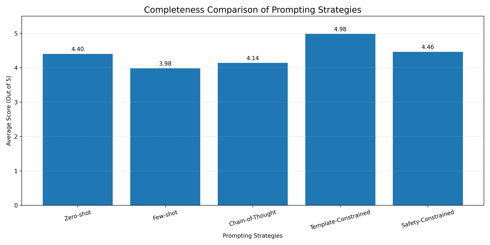
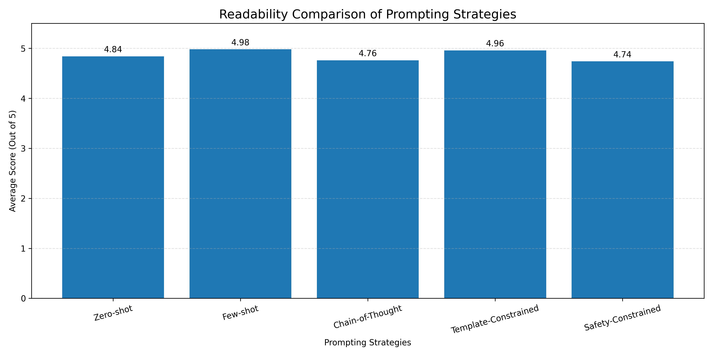
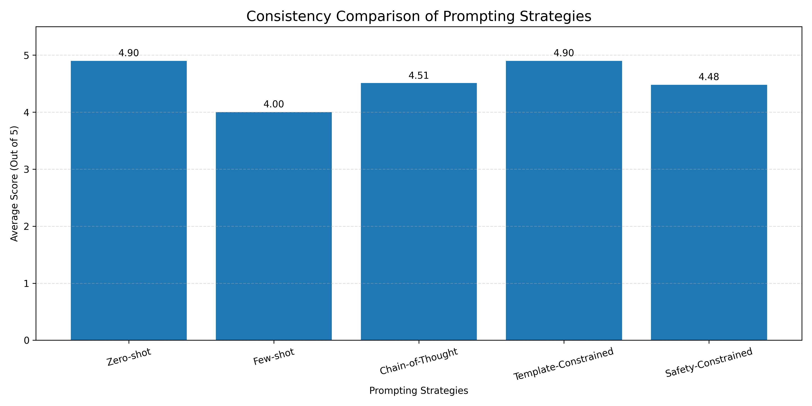
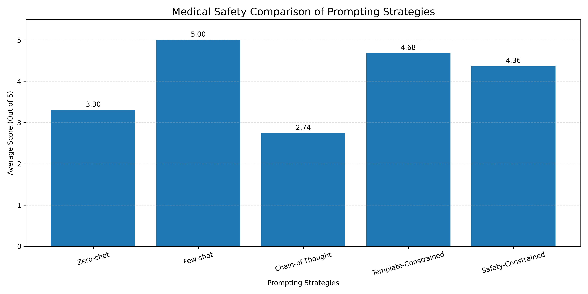
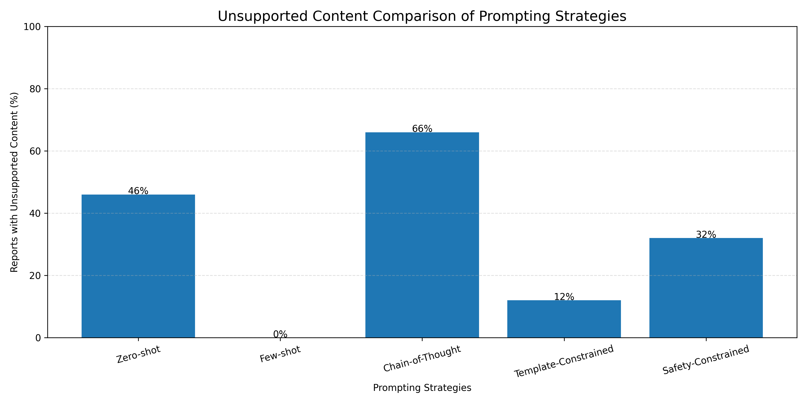

# Results and Discussion

## 1. CNN Model Evaluation Results

The EfficientNet-B0 model was trained using the APTOS 2019 Diabetic Retinopathy dataset to classify retinal images into five grades: No DR, Mild, Moderate, Severe, and Proliferative DR.

The model was evaluated on 550 test images. The performance was measured using accuracy, quadratic weighted kappa (QWK), precision, recall, and F1-score.

### 1.1 Overall Performance

| Evaluation Metric | Result |
|---|---:|
| Test Accuracy | 77.8% |
| Quadratic Weighted Kappa (QWK) | 0.863 |
| Macro Precision | 0.62 |
| Macro Recall | 0.64 |
| Macro F1-score | 0.61 |
| Weighted Precision | 0.80 |
| Weighted Recall | 0.78 |
| Weighted F1-score | 0.78 |
| Test Images | 550 |

The EfficientNet-B0 model achieved 77.8% test accuracy and a QWK score of 0.863. The weighted F1-score was 0.78, while the macro F1-score was 0.61.

### 1.2 Class-wise Performance

| DR Grade | Precision | Recall | F1-score |
|---|---:|---:|---:|
| No DR | 0.96 | 0.99 | 0.97 |
| Mild | 0.53 | 0.73 | 0.62 |
| Moderate | 0.78 | 0.60 | 0.68 |
| Severe | 0.31 | 0.59 | 0.41 |
| Proliferative DR | 0.48 | 0.30 | 0.37 |

The model performed best in identifying No DR images, with an F1-score of 0.97. However, lower performance was observed for Severe and Proliferative DR. This shows that some difficult DR grades are more challenging for the model to classify correctly.

Overall, the CNN provides the predicted DR grade and confidence score, which are used as input for the next stage of clinical-style report generation.

## 2. Prompt Strategy Evaluation Results

Five prompting strategies were evaluated using the same language model and the same CNN outputs.

A total of 250 reports were generated using 50 test cases and five prompting strategies.

The strategies evaluated were:

1. Zero-shot prompting
2. Few-shot prompting
3. Chain-of-Thought prompting
4. Template-Constrained prompting
5. Safety-Constrained prompting

Each strategy was evaluated using five measures:

- Completeness
- Readability
- Consistency
- Medical Safety
- Unsupported Content

The first four measures were scored on a scale of 0 to 5. Unsupported Content was evaluated using YES or NO.

### 2.1 Comparison of Average Scores

| Prompting Strategy | Completeness | Readability | Consistency | Medical Safety |
|---|---:|---:|---:|---:|
| Zero-shot | 4.40 | 4.84 | 4.90 | 3.30 |
| Few-shot | 3.98 | 4.98 | 4.00 | 5.00 |
| Chain-of-Thought | 4.14 | 4.76 | 4.51 | 2.74 |
| Template-Constrained | 4.98 | 4.96 | 4.90 | 4.68 |
| Safety-Constrained | 4.46 | 4.74 | 4.48 | 4.36 |

Note: Averages are calculated using valid scores only. Some entries were blank or invalid and were excluded from the corresponding average.

### 2.2 Unsupported Content Evaluation

Unsupported content was evaluated by checking whether the generated report included information that was not provided in the CNN output.

| Prompting Strategy | YES | NO | Unsupported Content (%) |
|---|---:|---:|---:|
| Zero-shot | 23 | 27 | 46% |
| Few-shot | 0 | 50 | 0% |
| Chain-of-Thought | 33 | 17 | 66% |
| Template-Constrained | 6 | 44 | 12% |
| Safety-Constrained | 16 | 34 | 32% |

A lower unsupported-content percentage indicates that fewer reports contained unsupported information.

Few-shot prompting had the lowest unsupported-content rate at 0%, while Chain-of-Thought prompting had the highest rate at 66%.

## 3. Comparison Charts

The following charts show the comparison of all five prompting strategies.

### 3.1 Completeness Comparison

### 3.2 Readability Comparison

### 3.3 Consistency Comparison

### 3.4 Medical Safety Comparison

### 3.5 Unsupported Content Comparison

## 4. Discussion

The experimental results show that different prompting strategies produce different levels of report quality. No single strategy performed best in every evaluation measure.

### 4.1 Zero-Shot Prompting

Zero-shot prompting achieved a consistency score of 4.90 and a readability score of 4.84. However, its medical safety score was 3.30, and 46% of the reports contained unsupported content.

This indicates that zero-shot prompting can generate clear and consistent reports, but it may include information that was not provided as input.

### 4.2 Few-Shot Prompting

Few-shot prompting achieved the highest readability score of 4.98 and the highest medical safety score of 5.00. It also recorded 0% unsupported content.

However, its completeness score was 3.98 and its consistency score was 4.00.

This shows that few-shot prompting produced readable and safer reports with very little unsupported information, although some reports did not include all the required information or fully match the CNN output.

### 4.3 Chain-of-Thought Prompting

Chain-of-Thought prompting achieved a readability score of 4.76 and a consistency score of 4.51. However, it recorded the lowest medical safety score of 2.74 and the highest unsupported-content rate of 66%.

This suggests that asking the language model to reason step by step may lead to additional details that are not supported by the given CNN output.

### 4.4 Template-Constrained Prompting

Template-Constrained prompting achieved the highest completeness score of 4.98. It also achieved a consistency score of 4.90 and a readability score of 4.96.

Its medical safety score was 4.68, and only 12% of reports contained unsupported content.

This indicates that providing a fixed report structure helps the language model generate complete, organised, and consistent reports.

### 4.5 Safety-Constrained Prompting

Safety-Constrained prompting achieved a completeness score of 4.46, a consistency score of 4.48, and a medical safety score of 4.36. Its unsupported-content rate was 32%.

It provided a balanced performance across the evaluation measures, but it did not achieve the highest score in any individual measure.

## 5. Key Findings

The main findings of the comparative study are:

1. Template-Constrained prompting achieved the highest completeness score of 4.98.
2. Few-shot prompting achieved the highest readability score of 4.98.
3. Zero-shot and Template-Constrained prompting achieved the highest consistency score of 4.90.
4. Few-shot prompting achieved the highest medical safety score of 5.00.
5. Few-shot prompting recorded the lowest unsupported-content rate of 0%.
6. Chain-of-Thought prompting recorded the highest unsupported-content rate of 66%.
7. Template-Constrained prompting provided strong completeness and consistency.
8. Different prompting strategies have different strengths and limitations.

Overall, the results show that the choice of prompting strategy has an important effect on the quality and safety of generated clinical-style reports.

Template-Constrained prompting was most effective for generating complete and consistent reports, while Few-shot prompting performed best in readability and medical safety. Therefore, the most suitable prompting strategy depends on the evaluation requirement.

## 6. Limitations

The study has the following limitations:

1. The experiment used only 50 test cases for comparing prompting strategies.
2. Only one language model was used for report generation.
3. The evaluation was based on predefined scoring criteria and was not clinically validated by medical professionals.
4. The CNN model showed lower classification performance for some DR grades, especially Severe and Proliferative DR.
5. The generated reports depend on the correctness of the CNN predictions and the information provided to the language model.

Therefore, the generated reports are intended for research and educational purposes and should not be considered a replacement for professional medical diagnosis.

## 7. Conclusion

This study compared five prompting strategies for generating clinical-style reports from CNN-based Diabetic Retinopathy grading results.

The EfficientNet-B0 model achieved 77.8% test accuracy and a QWK score of 0.863. Its predicted grade, stage, and confidence score were used as inputs for generating reports using five different prompting strategies.

The evaluation showed that Template-Constrained prompting performed best in completeness and achieved strong consistency. Few-shot prompting performed best in readability and medical safety, with no unsupported content identified in the evaluated reports.

The findings demonstrate that prompt design plays an important role in generating clear, complete, consistent, and safer clinical-style reports. Further work can include testing more cases, evaluating additional language models, and obtaining expert medical evaluation.
